# Post-contenido Unidad 6: MVC formal con Front Controller, sesiones, roles e i18n

**Estudiante:** Nicolás Andrés Sánchez Villamizar
**Asignatura:** Programación Web, Universidad de Santander (UDES)
**Repositorio:** `sanchez-post1-u6-pweb`

## Descripción

Este repositorio tiene un único proyecto Maven Web (`gestor-tareas-mvc`) que retoma el gestor de tareas de la Unidad 5, pero reconstruido desde cero con el patrón MVC formal. Toda petición entra por un solo Servlet, `FrontControllerServlet`, mapeado a `/app`, y ese Servlet delega cada operación en un objeto Comando. En la Parte 1 se arma el Front Controller con el CRUD de tareas sin autenticación. En la Parte 2 se extiende ese mismo Front Controller con verificación de sesión centralizada, login y logout con roles (ADMIN y USER), validación del formulario con mensajes por campo y un selector de idioma que se guarda en una cookie y se resuelve con `ResourceBundle`.

## Prerrequisitos

- JDK 17 o superior (yo lo trabajé con JDK 23, compilando con `release 17`).
- Apache Tomcat 10.1.x (Jakarta EE 10, puerto 8080 libre).
- Maven 3.8 o superior.
- IntelliJ IDEA (o cualquier IDE con soporte Maven).
- Git y cuenta de GitHub.

## Estructura del proyecto

```
sanchez-post1-u6-pweb/
├── pom.xml
├── README.md
├── docs/capturas/                      capturas del navegador y la terminal
└── src/main/
    ├── java/com/ejemplo/mvc/
    │   ├── model/                      Tarea, TareaDAO, Usuario, UsuarioDAO
    │   ├── service/                    TareaService, AutenticacionService
    │   └── controller/
    │       ├── FrontControllerServlet.java
    │       └── comando/                Comando + 8 comandos concretos
    ├── resources/                      messages.properties, messages_es.properties
    └── webapp/
        ├── index.jsp
        ├── css/estilos.css
        └── WEB-INF/
            ├── web.xml
            └── views/                  lista.jsp, formulario.jsp, login.jsp
```

## Cómo compilar y ejecutar

1. Clonar el repositorio:
   ```
   git clone https://github.com/NicolasSnchz/sanchez-post1-u6-pweb.git
   cd sanchez-post1-u6-pweb
   ```
2. Compilar y empaquetar:
   ```
   mvn clean package
   ```
   Esto genera `target/gestor-tareas-mvc.war`.
3. Desplegar, con cualquiera de estas dos opciones:
   - **IntelliJ IDEA:** Run → Edit Configurations → + → Tomcat Server → Local. En la pestaña Deployment se agrega el artefacto `gestor-tareas-mvc:war exploded` con contexto `/gestor-tareas-mvc` y se ejecuta.
   - **Tomcat directo:** copiar `target/gestor-tareas-mvc.war` a la carpeta `webapps` de Tomcat y arrancarlo con `bin/startup.bat` (Windows) o `bin/startup.sh`.
4. Abrir `http://localhost:8080/gestor-tareas-mvc/app`.

Como las dos partes viven en el mismo proyecto, la Parte 1 se puede ejecutar tal como quedó entregada haciendo `git checkout 1199f19` (último commit de la Parte 1) antes del paso 2. En ese estado no hay login y `/app` muestra directamente el listado. Con `git checkout main` se vuelve a la versión final con la Parte 2.

### Usuarios de prueba (Parte 2)

| Usuario | Contraseña | Rol | Puede eliminar |
|---|---|---|---|
| `admin` | `Admin123!` | ADMIN | Sí |
| `maria` | `Maria2026!` | USER | No |

## Funcionalidades implementadas

**Parte 1**
- Front Controller único en `/app`; si no llega el parámetro `comando`, se lista.
- Listado de tareas con las 3 tareas precargadas.
- Registro de tareas con Post/Redirect/Get (después de guardar, la URL queda en `/app?comando=listar`).
- Completar tarea (se muestra tachada) y eliminar tarea con diálogo de confirmación.
- Comando desconocido responde 404.
- Nombre de la aplicación y longitud máxima del título leídos desde `web.xml` (contexto de aplicación).

**Parte 2**
- Verificación de sesión en un solo punto del Front Controller: sin sesión, cualquier comando protegido redirige a `/app?comando=login`.
- Login con mensaje de error si las credenciales no coinciden, y logout que invalida la sesión.
- Saludo con nombre y rol del usuario en el listado.
- Solo el rol ADMIN puede eliminar; un USER recibe el mensaje de restricción y la tarea no se borra.
- Validación en el servidor por campo (título obligatorio y máximo 80 caracteres, categoría obligatoria, prioridad válida, fecha con formato `yyyy-MM-dd` y no pasada), mostrando cada error junto a su campo y repoblando lo que el usuario ya había escrito.
- Selector Español / English guardado en la cookie `idiomaPreferido` (30 días), que sigue vigente después de cerrar sesión.

## Decisiones de diseño

### 1. Front Controller en vez de un Servlet por acción

En la Unidad 5 las operaciones estaban en un `switch` dentro de un Servlet y había otro Servlet aparte para el detalle. Aquí todo entra por [`FrontControllerServlet`](src/main/java/com/ejemplo/mvc/controller/FrontControllerServlet.java#L15-L16), que en `init()` arma un mapa nombre → Comando ([líneas 34 a 43](src/main/java/com/ejemplo/mvc/controller/FrontControllerServlet.java#L34-L43)) y en [`procesar()`](src/main/java/com/ejemplo/mvc/controller/FrontControllerServlet.java#L59-L84) resuelve el comando con un `get` del mapa. Agregar una operación nueva es crear una clase y registrar una línea en el mapa, sin tocar el método de enrutamiento. Además, los comandos se crean una sola vez y comparten la misma instancia de `TareaService`, así que no se crea un servicio por petición.

### 2. El Comando devuelve la vista, no hace el forward

La interfaz [`Comando`](src/main/java/com/ejemplo/mvc/controller/comando/Comando.java#L8-L16) devuelve la ruta de la JSP o `null` si el comando ya respondió con un redirect. El único `forward` de toda la aplicación está en [`FrontControllerServlet` líneas 80 a 83](src/main/java/com/ejemplo/mvc/controller/FrontControllerServlet.java#L80-L83). Si cada comando hiciera su propio `getRequestDispatcher(...).forward(...)`, esa misma línea quedaría repetida en todos, y el controlador perdería el control de lo que pasa antes y después de ejecutar el comando, que es justo lo que se aprovecha en la Parte 2.

### 3. Verificación de sesión centralizada

El chequeo de sesión está una sola vez, en [`procesar()` líneas 64 a 72](src/main/java/com/ejemplo/mvc/controller/FrontControllerServlet.java#L64-L72), antes de buscar el comando. Los comandos públicos están declarados en el conjunto [`PUBLICOS`](src/main/java/com/ejemplo/mvc/controller/FrontControllerServlet.java#L18) (`login` e `idioma`), y todo lo demás queda protegido por defecto. Eso tiene una ventaja de seguridad concreta: si mañana se agrega un comando nuevo, queda protegido sin escribir nada extra, mientras que con un Servlet por acción habría que acordarse de copiar el `if` en cada uno, y el día que se olvide queda una ruta abierta. Por eso [`EliminarComando`](src/main/java/com/ejemplo/mvc/controller/comando/EliminarComando.java#L18-L21) puede usar `getSession(false)` y leer el usuario directamente: cuando llega ahí ya está garantizado que hay sesión. Lo único que revisa el comando es el rol, porque esa regla es propia de esa operación y no de todas.

### 4. Usuario en HttpSession, idioma en Cookie

[`LoginComando`](src/main/java/com/ejemplo/mvc/controller/comando/LoginComando.java#L34-L36) guarda el objeto `Usuario` en la sesión con 30 minutos de inactividad, y [`LogoutComando`](src/main/java/com/ejemplo/mvc/controller/comando/LogoutComando.java#L13) la invalida. El usuario y su rol tienen que desaparecer cuando la sesión termina, y además viven del lado del servidor, así que el cliente no puede cambiarse el rol a mano. El idioma es lo contrario: no es un dato sensible y conviene que dure más que la sesión, para que la propia pantalla de login salga en el idioma elegido. Por eso [`IdiomaComando`](src/main/java/com/ejemplo/mvc/controller/comando/IdiomaComando.java#L13-L18) solo acepta `es` o `en` (no se guarda cualquier valor que llegue por la URL) y crea una cookie de 30 días con path `/`. Las vistas la leen directo con el objeto implícito de EL `cookie` en [`fmt:setLocale`](src/main/webapp/WEB-INF/views/lista.jsp#L4-L5), sin pasar por atributos de request ni de sesión. En las pruebas se ve que después del logout el `JSESSIONID` cambia pero `idiomaPreferido=en` se mantiene.

### 5. Validación por campo con mapa de errores

[`GuardarComando`](src/main/java/com/ejemplo/mvc/controller/comando/GuardarComando.java#L30-L59) valida todos los campos y va acumulando los mensajes en un `LinkedHashMap` con la clave del campo, en vez de cortar en el primer error. Así el usuario ve todos los problemas de una vez y cada mensaje sale al lado de su campo con `${errores.titulo}`, `${errores.fechaLimite}`, etc. Se usa `LinkedHashMap` para que la lista resumen respete el orden del formulario. Cuando hay errores se devuelven también los valores escritos ([líneas 61 a 67](src/main/java/com/ejemplo/mvc/controller/comando/GuardarComando.java#L61-L67)) y [`formulario.jsp`](src/main/webapp/WEB-INF/views/formulario.jsp#L20) los repinta con `<c:out>`, que escapa el HTML y evita que un título con `<script>` se ejecute al volver al formulario. La validación se hace en el servidor y no con `required` de HTML, porque esa validación del navegador se puede saltar con cualquier cliente HTTP.

### 6. Longitud máxima del título desde el contexto de aplicación

El límite de 80 caracteres está como `context-param` en [`web.xml`](src/main/webapp/WEB-INF/web.xml#L11-L14), el Front Controller lo carga una sola vez en el `ServletContext` ([líneas 29 a 31](src/main/java/com/ejemplo/mvc/controller/FrontControllerServlet.java#L29-L31)) y `GuardarComando` lo lee de ahí ([líneas 28 y 29](src/main/java/com/ejemplo/mvc/controller/comando/GuardarComando.java#L28-L29)). Es un dato global e inmutable, compartido por todos los usuarios, así que el contexto de aplicación es el lugar correcto. Para cambiar la regla basta con editar `web.xml` y redesplegar, sin recompilar el comando.

## Correcciones al enunciado

Revisando el código de la guía contra la rúbrica y los checkpoints encontré algunas cosas que no cuadraban y las corregí:

1. **`index.jsp` tenía un scriptlet.** La guía usa `<% response.sendRedirect(...) %>`, pero la rúbrica pide vistas "solo EL/JSTL sin scriptlets" y baja de nivel por "un uso puntual de scriptlets". Lo cambié por [`<c:redirect url="/app"/>`](src/main/webapp/index.jsp#L3), que hace lo mismo y además le agrega el contexto de la aplicación a la URL.
2. **El orden de commits de la Parte 2 no compilaba.** El segundo commit sugerido sube `FrontControllerServlet` ya registrando `new IdiomaComando()`, pero `IdiomaComando.java` recién se sube en el cuarto commit, así que los commits intermedios no compilaban. Mantuve la misma secuencia y los mismos mensajes, pero el registro de `idioma` (y su entrada en `PUBLICOS`) entra en el commit de internacionalización. Revisé que cada commit del historial compile.
3. **La validación de fecha rechazaba la fecha de hoy y aceptaba fechas imposibles.** El código de la guía compara con `fechaLimite.before(new Date())`: como la fecha parseada queda a medianoche y `new Date()` es la hora actual, una tarea con fecha límite de hoy salía como "en el pasado". Además `SimpleDateFormat` es permisivo por defecto y convierte `2026-02-30` en el 2 de marzo sin avisar, y el código atrapaba `NullPointerException`, que no es buena práctica. Lo reemplacé por [`LocalDate.parse` y `isBefore(LocalDate.now())`](src/main/java/com/ejemplo/mvc/controller/comando/GuardarComando.java#L48-L59): el formato ISO es estricto, la comparación es por día y el campo vacío se trata como formato inválido sin depender de una excepción. Los mensajes de error son los mismos de la guía.
4. **El listado quedaba mitad en inglés.** Con English seleccionado, la columna Estado seguía diciendo "Pendiente/Completada" y el diálogo de confirmación seguía en español. Agregué las claves `lista.completada`, `lista.pendiente` y `lista.confirmar` a los dos `.properties` y las usé en [`lista.jsp`](src/main/webapp/WEB-INF/views/lista.jsp#L49-L54).
5. **Ubicación del proyecto.** La sección de entregables habla de una carpeta `gestor-tareas-mvc/`, pero el Paso 1, el árbol de carpetas y los `git add pom.xml src/...` del enunciado ponen el `pom.xml` en la raíz del repositorio. Seguí el árbol y los comandos del Paso 1 (proyecto en la raíz) y dejé `artifactId` y `finalName` como `gestor-tareas-mvc`, así la URL sigue siendo `/gestor-tareas-mvc/app`.
6. **`pom.xml` para JDK reciente.** Cambié `maven.compiler.source/target` por `release 17` con `maven-compiler-plugin` 3.13.0 y fijé `maven-war-plugin` 3.4.0, porque la versión vieja del plugin WAR que trae el arquetipo falla en JDK 17 o superior. También declaré la codificación UTF-8 para que los `.properties` con tildes se copien bien.

## Pruebas realizadas

Probé la aplicación desplegada en Tomcat 10.1, tanto en el navegador como con peticiones `curl` para ver los códigos HTTP y las redirecciones.

| Checkpoint | Resultado |
|---|---|
| `/app` sin `comando` carga el listado con 3 tareas (Parte 1) | Correcto |
| Guardar redirige a `/app?comando=listar` (PRG) | 302 a `?comando=listar` |
| Completar tacha la tarea; Eliminar pide confirmación y la quita | Correcto |
| Sin sesión, `/app?comando=listar` redirige a login | 302 a `?comando=login` |
| Credenciales incorrectas muestran error en la misma página | Correcto |
| `admin` ve saludo con rol ADMIN y puede eliminar | Correcto |
| `maria` (USER) intenta eliminar: mensaje y la tarea no se borra | Correcto |
| Título vacío + fecha inválida: dos errores junto a sus campos, categoría y prioridad conservadas | Correcto |
| Título de 81 caracteres (límite de `web.xml`) | Error por campo |
| English cambia encabezados y botones; tras logout y sin `JSESSIONID` el idioma se mantiene | Correcto |
| Errores en `catalina.out` durante el flujo | 0 |

## Capturas

### Parte 1

Listado inicial en `/app` con las tres tareas precargadas:

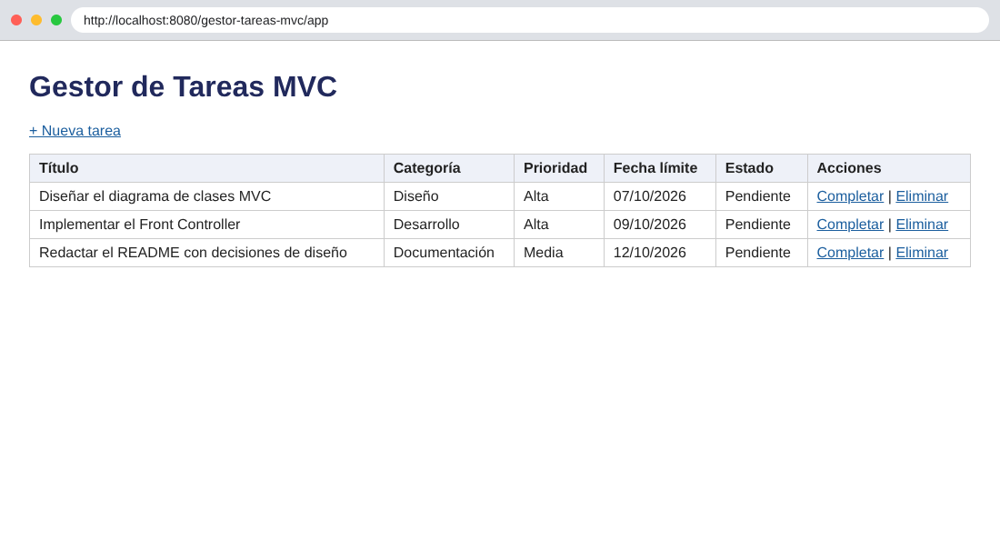

Formulario de nueva tarea:

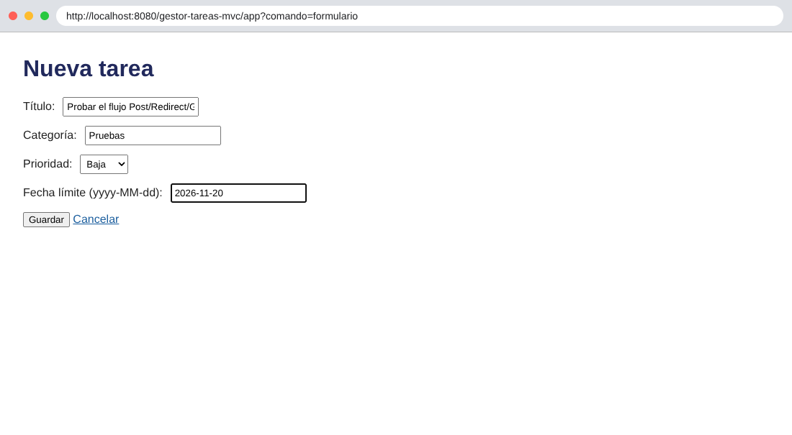

Después de guardar, la URL queda en `?comando=listar` (Post/Redirect/Get):

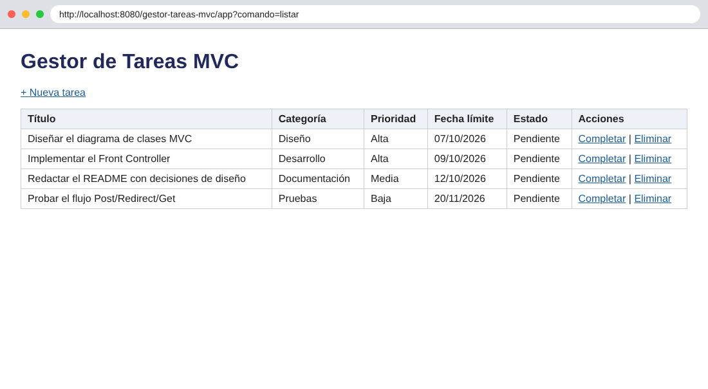

Tarea completada (tachada):

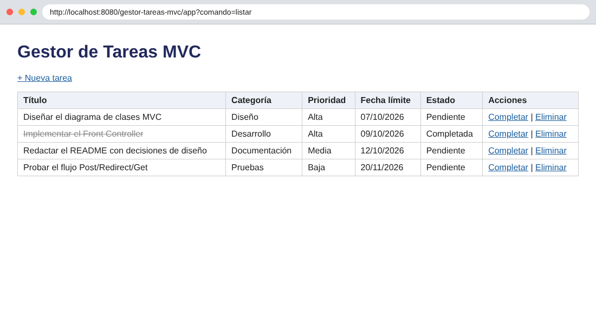

Tarea eliminada después de aceptar el diálogo "¿Eliminar esta tarea?":

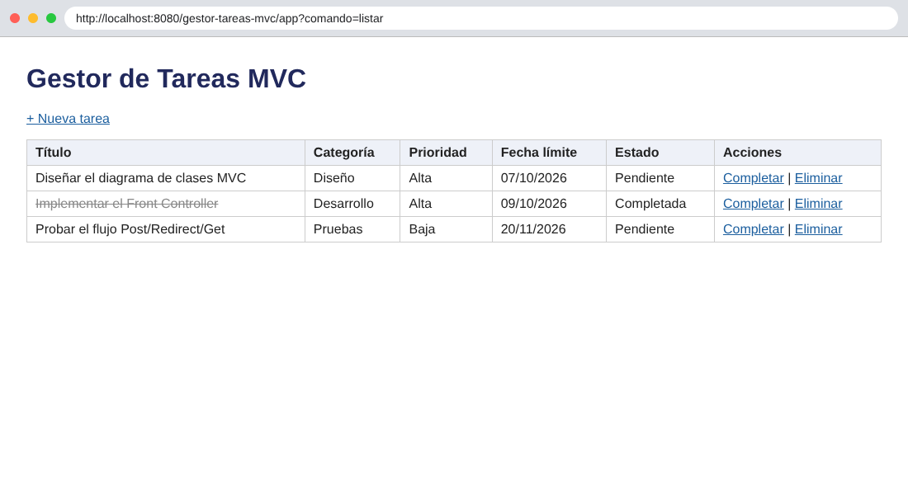

### Parte 2

Acceso a `?comando=listar` sin sesión, redirigido al login:

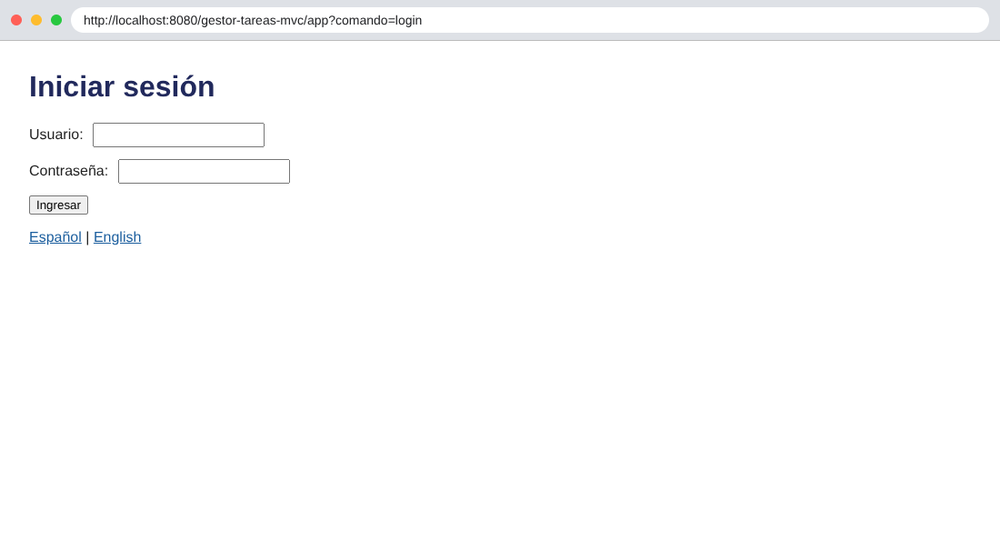

Credenciales incorrectas:

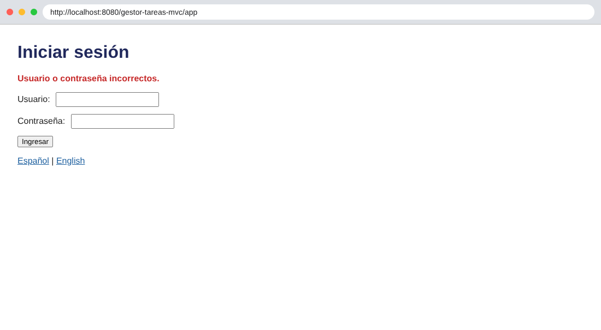

Listado con sesión de administrador:

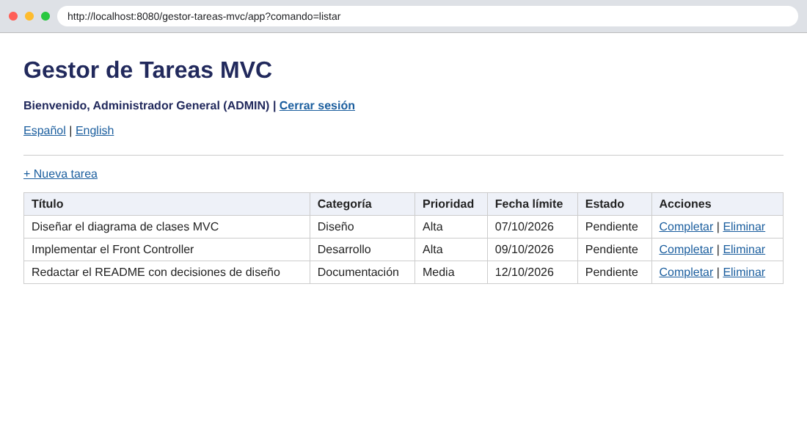

El administrador elimina una tarea:

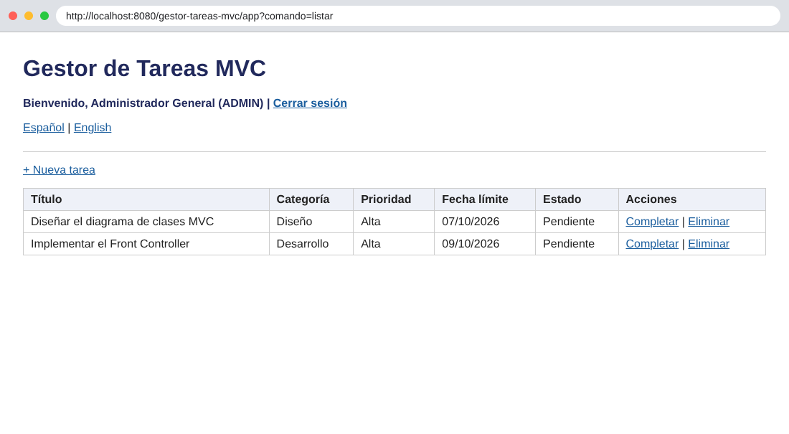

Restricción de rol: `maria` (USER) intenta eliminar:

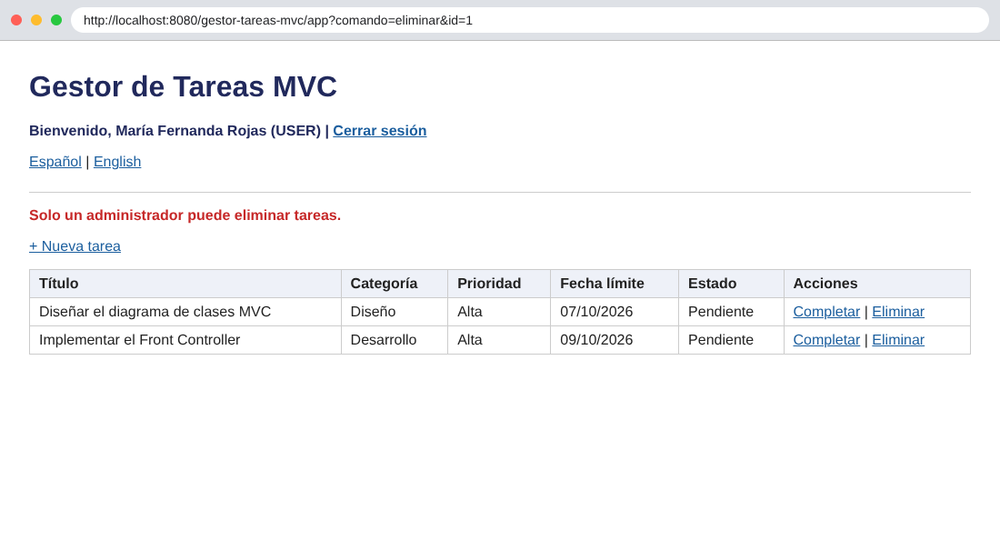

Validación por campo con título vacío y fecha inválida a la vez, conservando categoría y prioridad:

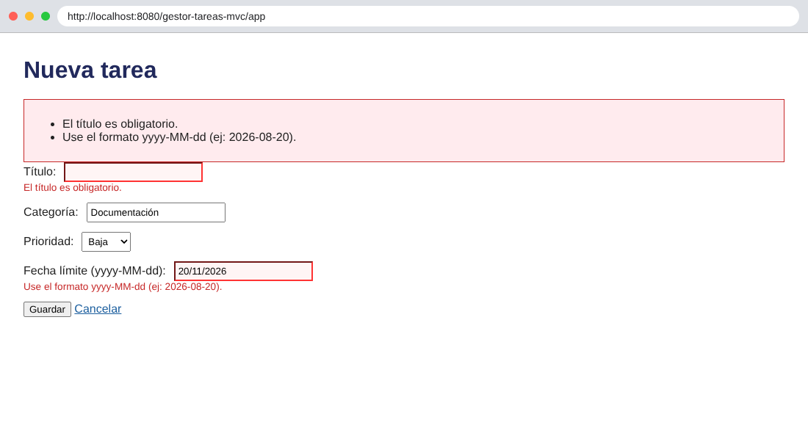

Título de más de 80 caracteres y fecha en el pasado:

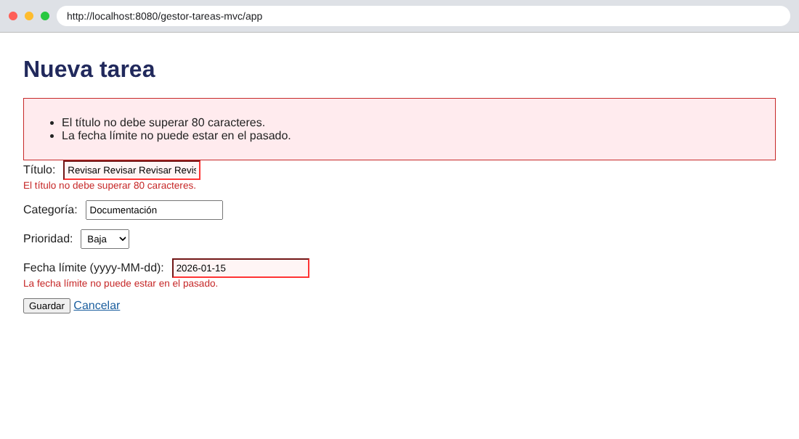

Selector de idioma en English:

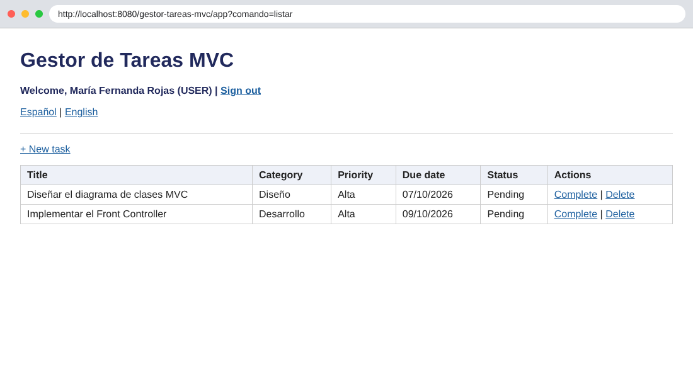

Después de cerrar sesión y borrar el `JSESSIONID`, el login sigue en inglés porque el idioma vive en la cookie:

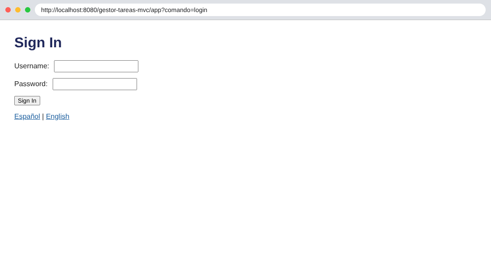

### Terminal

Compilación y despliegue en Tomcat 10.1:

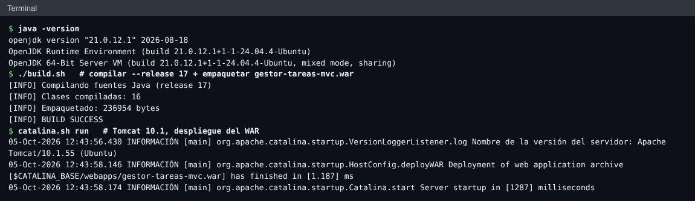

Checkpoints de la Parte 2 probados con `curl`:

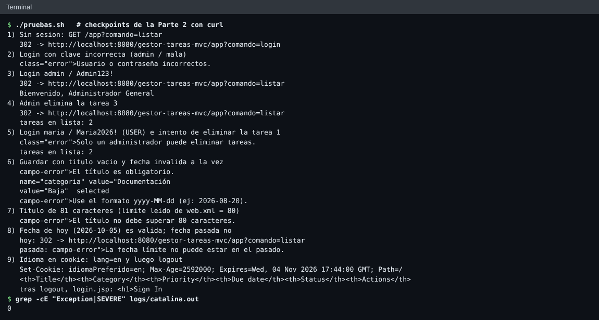

Historial de commits de ambas partes:

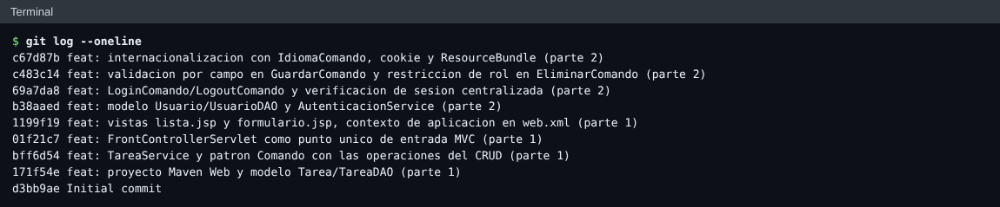
